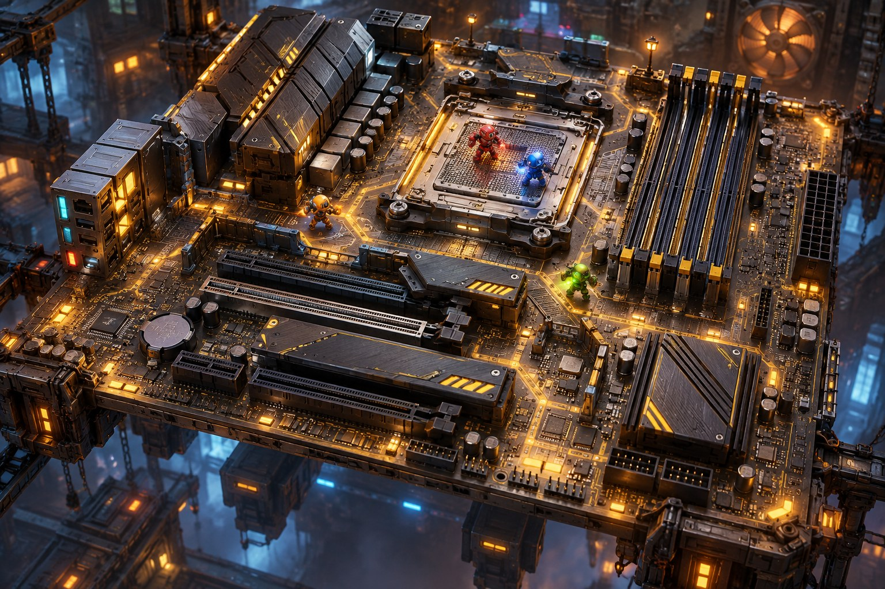

# 第一张地图：重装战场

这张 AI 生成的概念图以华硕 TUF GAMING B650-PLUS WIFI 主板为灵感，展示未来地图的视觉方向，并非现有游戏场景或可直接使用的 3D 模型。参考：[华硕产品页面](https://www.asus.com/motherboards-components/motherboards/tuf-gaming/tuf-gaming-b650-plus-wifi/)。

- CPU 插槽：中央战斗区。
- 内存插槽：平行障碍物与穿行路线。
- 散热装甲：掩体和高台。
- PCIe 插槽：长条通道。
- 电路走线：地面装饰，可用于未来机关。

当前试玩场景由 `frontend/src/game/Game.ts` 中的 Three.js 几何体生成，已加入 CPU 平台、内存槽、散热装甲与 PCIe 插槽等简化元素。它是概念图的可玩原型，细节与概念图有所区别。
